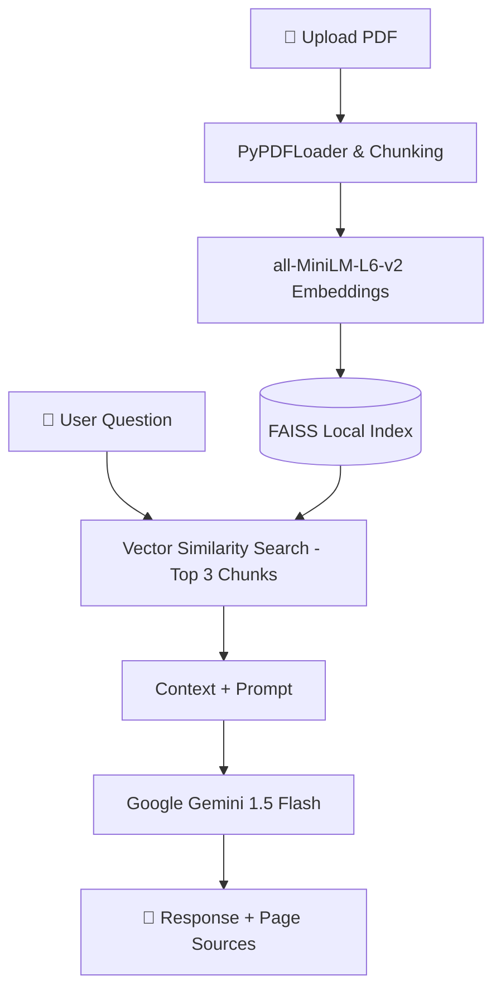

# DocuMind 📄

> **Private RAG Document Assistant** powered by LangChain, Google Gemini, FAISS, and Streamlit.

[](https://www.python.org/)
[](https://streamlit.io/)
[](https://www.langchain.com/)
[](https://github.com/facebookresearch/faiss)
[](https://aistudio.google.com/)

---

## 🌟 Overview

**DocuMind** is an intelligent, private Retrieval-Augmented Generation (RAG) assistant that allows users to upload any PDF document and ask contextual questions via a clean, conversational chat interface.

DocuMind combines local dense embeddings and similarity search with Google's state-of-the-art **Gemini 1.5 Flash** model to provide rapid, hallucination-resistant answers with precise **source page citations**.

---

## ✨ Features

- 📑 **Smart PDF Ingestion**: Automatic parsing and recursive text chunking with metadata preservation.
- 🧠 **Local Vector Search**: Powered by `sentence-transformers/all-MiniLM-L6-v2` and `FAISS` for private, low-latency, and zero-cost vector indexing.
- ⚡ **Google Gemini 1.5 Flash**: Delivers lightning-fast, high-quality responses conditioned strictly on your document.
- 📌 **Source Attribution**: Highlights exact page numbers where information was retrieved.
- 💬 **Interactive Chat UI**: Intuitive Streamlit interface with conversation history and a "Clear Chat" feature.
- 🔐 **Privacy-First**: Vector embeddings are generated and stored locally on your machine.

---

## 🏗️ Architecture



---

## 🛠️ Tech Stack

| Component | Technology | Description |
|---|---|---|
| **Frontend** | Streamlit | Responsive web UI and chat components |
| **Orchestration** | LangChain | Document chains and retrieval pipelines |
| **LLM** | Google Gemini 1.5 Flash | Conversational reasoning and Q&A |
| **Embeddings** | Hugging Face Sentence Transformers | `all-MiniLM-L6-v2` for dense embeddings |
| **Vector DB** | Meta FAISS (CPU) | High-performance similarity search |
| **PDF Extraction** | PyPDF | PDF document parsing and page mapping |

---

## 📁 Project Structure

```text
DocuMind/
├── src/
│   ├── pdf_loader.py        # PDF parsing and recursive chunking
│   ├── vector_store.py      # Embedding generation & FAISS index management
│   └── rag_chain.py         # Gemini LLM and retrieval prompt chain
├── app.py                   # Streamlit UI & application entrypoint
├── requirements.txt         # Project dependencies
├── .env.example             # Environment variable template
├── .gitignore               # Git ignore rules (protects .env and caches)
└── README.md                # Project documentation
```

---

## 🚀 Getting Started

### 1. Prerequisites

- Python 3.10 to 3.13 installed ([Python Downloads](https://www.python.org/downloads/))
- Git installed
- A Google Gemini API Key ([Get one free at Google AI Studio](https://aistudio.google.com/))

### 2. Clone the Repository

```bash
git clone https://github.com/viratsharma22/DocuMind.git
cd DocuMind
```

### 3. Create a Virtual Environment

**Windows (PowerShell):**
```powershell
python -m venv .venv
.\.venv\Scripts\Activate.ps1
```

**macOS / Linux:**
```bash
python3 -m venv .venv
source .venv/bin/activate
```

### 4. Install Dependencies

```bash
pip install --upgrade pip
pip install -r requirements.txt
```

### 5. Configure API Key

Create a `.env` file in the project root:

```bash
cp .env.example .env
```

Open `.env` and add your Google API Key:

```env
GOOGLE_API_KEY=your_actual_google_gemini_api_key
```

---

## 🖥️ Running the Application

Launch the Streamlit app:

```bash
streamlit run app.py
```

Or run directly using the virtual environment:

```powershell
.\.venv\Scripts\streamlit run app.py
```

Open your browser at `http://localhost:8501`.

1. Upload a PDF file using the sidebar.
2. Wait for the analysis confirmation.
3. Start chatting and asking questions about your document!

---

## 🔒 Security & Privacy

- Your `.env` file contains sensitive API keys and is automatically excluded from git commits via `.gitignore`.
- FAISS indexes are stored locally and are not pushed to public repositories.

---

## 🤝 Contributing

Contributions are welcome! Please feel free to open an issue or submit a pull request:

1. Fork the Project
2. Create your Feature Branch (`git checkout -b feature/AmazingFeature`)
3. Commit your Changes (`git commit -m 'Add some AmazingFeature'`)
4. Push to the Branch (`git push origin feature/AmazingFeature`)
5. Open a Pull Request

---

## 📄 License

This project is open source and available under the [MIT License](LICENSE).
